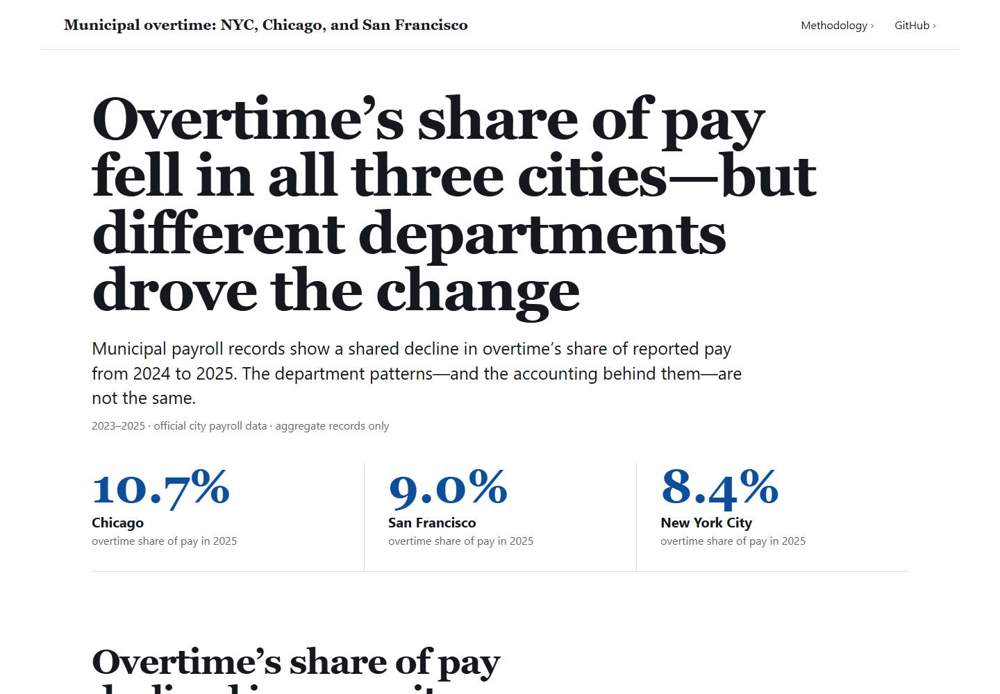
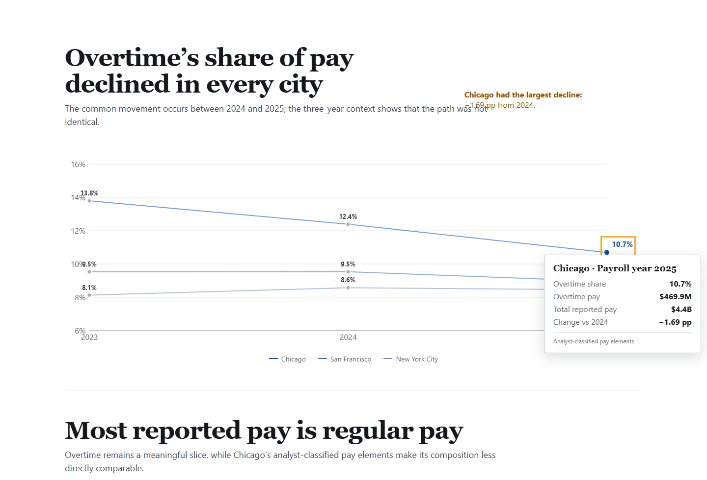
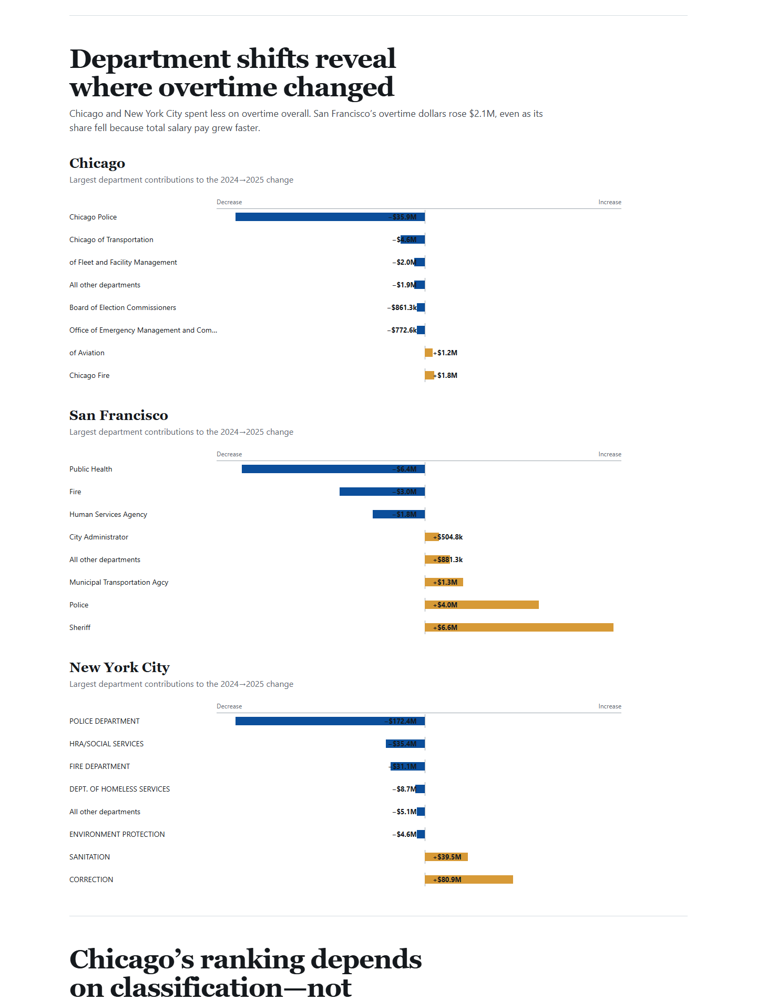
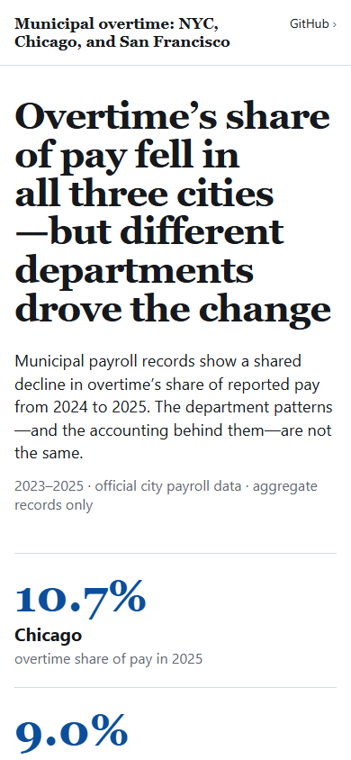

# Municipal overtime: NYC, Chicago, and San Francisco

An interactive, source-backed data story comparing municipal payroll overtime in New York City, Chicago, and San Francisco. The report uses aggregate official open-data queries only; it does not download or store employee names or employee-level payroll records.

`data analytics` · `data visualization` · `Storytelling with Data` · `municipal payroll` · `public data` · `React` · `TypeScript` · `Python`

[View the live report](https://dhruvshah-dev.github.io/municipal-payroll-comparison/) · [Review the analysis](analyze.py) · [Inspect the validated snapshot](data/story_data.json)



The canonical experience is the React application in [`app`](app). The legacy [`report.html`](report.html) and [`comparison.html`](comparison.html) paths redirect to the new story.

## What the refreshed analysis shows

The latest common complete comparison window is **2023–2025**. Chicago's 2026 data contains fewer than 24 payroll periods, so 2026 is excluded automatically.

| City | 2025 overtime pay | 2025 reported pay | 2025 overtime share | Change vs. 2024 |
| --- | ---: | ---: | ---: | ---: |
| Chicago | $469.9M | $4.394B | 10.69% | −1.69 pp |
| New York City | $2.922B | $34.596B | 8.45% | −0.13 pp |
| San Francisco | $471.0M | $5.258B | 8.96% | −0.58 pp |

- Overtime's share of reported pay fell from 2024 to 2025 in all three datasets.
- Chicago's decline was dominated by a $35.9M reduction in police overtime.
- New York City's $172.4M police decrease was partly offset by increases in corrections and sanitation.
- San Francisco overtime dollars rose $2.1M even though overtime share fell; total salary pay grew faster.
- The top five departments account for about 91.8% of Chicago overtime, 87.6% in San Francisco, and 83.1% in New York City.

These figures describe payroll composition and department-level movement. They do not measure productivity, fairness, staffing adequacy, hours worked, or service quality.

## Visual story

The report follows a focused narrative: establish the shared citywide decline, then reveal the department movements and classification choices behind it. Primary values are directly labeled; the interactive tooltip adds detail without being required to understand the chart.

### Overtime share, 2023–2025



### Department contributions to the 2024–2025 change



### Responsive report

<p align="center">
  
</p>

## Metric and comparability

`Overtime share = overtime pay / (regular pay + overtime pay + other pay)`.

NYC and San Francisco publish overtime fields. Chicago publishes pay elements, so [`analyze.py`](analyze.py) classifies elements whose names begin with `OT` or contain `OVERTIME` or `QUARTERLY OT` as an analyst-defined overtime proxy. Removing Chicago's $161.1M `PR YR RETRO PEN` item from the 2025 denominator raises its overtime share from 10.69% to 11.10%, still below 2024's 12.39%.

NYC and San Francisco use fiscal years ending June 30. Chicago uses 24 payroll periods that do not necessarily match the dates when work was performed. Department responsibilities and workforce coverage also differ.

## Official sources

- [NYC Citywide Payroll Data (Fiscal Year)](https://data.cityofnewyork.us/City-Government/Citywide-Payroll-Data-Fiscal-Year-/k397-673e)
- [Chicago Employee Payroll Data (FMPS Payroll Costing)](https://data.cityofchicago.org/Administration-Finance/Employee-Payroll-Data-FMPS-Payroll-Costing-/dawh-m56b)
- [San Francisco Employee Compensation](https://data.sfgov.org/City-Management-and-Ethics/Employee-Compensation/88g8-5mnd)

San Francisco publishes overlapping fiscal and calendar records; this project uses `Fiscal` only. Its [dataset FAQ](https://sfdigitalservices.gitbook.io/dataset-explainers/employee-compensation-faq) explains why employees can appear on multiple rows and why negative adjustments may occur. Source row counts are therefore not treated as comparable employee headcounts.

## Reproduce the analysis and report

Requirements: Python 3.11+, Node.js 20+, and network access for the source refresh.

```powershell
python analyze.py
python validate_snapshot.py

cd app
npm install
npm run test:run
npm run build
npm run e2e
```

`analyze.py` discovers the latest three years that are present in all sources and complete in Chicago, then writes:

- `data/story_data.json`: typed, chart-ready snapshot and source metadata.
- `data/city_year_summary.csv`: city-year measures.
- `data/department_year.csv`: department-year aggregates.
- `data/run_metadata.json`: retrieval time and completed checks.

`validate_snapshot.py` checks nine city-year rows, pay-component arithmetic, Chicago's 24-period coverage, department-to-city reconciliation, driver reconciliation, top-five rankings, sensitivity ordering, finite values, and compatibility pages.

The Vite application imports the reviewed JSON at build time. The production build is a static site with relative asset paths and compatibility redirects. GitHub Actions validates the data, runs unit and browser tests, builds the app, and deploys `app/dist` to GitHub Pages from `main`.

## Interaction and accessibility

- Primary values are directly labeled; hover is never the only way to read the main result.
- Every interactive chart mark supports pointer hover and keyboard focus.
- Tooltips include the reporting basis, relevant dollars, shares, comparison change, denominator context, and Chicago classification note where applicable.
- The report uses semantic sections, visible focus, a skip link, reduced-motion support, responsive layouts, and automated axe checks.

The committed aggregate snapshot was refreshed **November 5, 2026**. Official portals may revise historical records, so rerunning the extractor can change the results.

## Keywords and tags

**Keywords:** municipal payroll analysis, overtime analysis, NYC payroll, Chicago payroll, San Francisco employee compensation, public-sector data, open-data analysis, Socrata API, accessible charts, responsive data story, department overtime, fiscal-year comparison, reproducible analytics.

**Tags:** `#DataAnalytics` `#DataVisualization` `#StorytellingWithData` `#MunicipalPayroll` `#PublicData` `#OpenData` `#React` `#TypeScript` `#Recharts` `#Python` `#Socrata` `#Accessibility` `#PortfolioProject`
